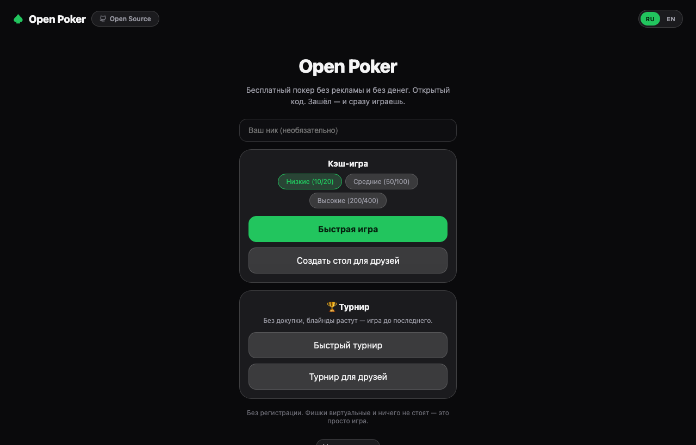
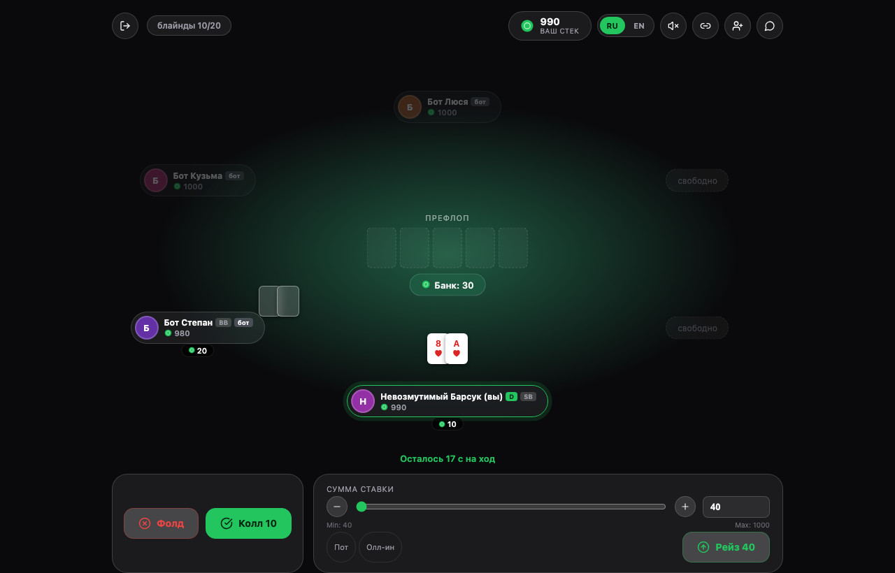

# [Open Poker](https://github.com/Trawling/open-poker)

[](https://github.com/Trawling/open-poker/actions/workflows/ci.yml)
[](LICENSE)
[](https://github.com/Trawling/open-poker/releases/latest)



Open Poker is a free online Texas Hold'em server focused on realtime gameplay
and zero friction — in the spirit of [Lichess](https://lichess.org) for chess.
Open the link and you're playing: no sign-up, no real money, no ads, forever.

It features cash games at several stake levels, Sit & Go tournaments with
escalating blinds, a lightweight "identity code" that lets you continue on
another device without an account, table chat, hand history, per-player
stats, and [provably fair dealing](#fairness) — the server seed hash is
published before every hand, so it can't be changed after the fact. Equity-aware
bots fill empty seats so a table is never stuck waiting for a ninth player.

The UI is available in **Russian and English**; adding another language is a
single JSON file (see [Contributing](#contributing-and-translations)).

A native [Android app](#android-app) (Capacitor, not tied to any single
server) is built straight from this repository and is being prepared for
F-Droid.

## Architecture

```
packages/engine/   pure game logic (deck, hand evaluation, betting rounds,
                    side pots, equity) — no I/O, fully unit tested
backend/            Node.js + TypeScript + Socket.IO: table/tournament
                    rooms, bots, persistence, stats, the realtime protocol
frontend/           React + TypeScript + Vite, talks to the backend over
                    the same WebSocket protocol the Android app also uses
frontend/android/   Capacitor wrapper around the same frontend build —
                    a real Gradle project, not a thin web view hack
```

Table/tournament state lives in memory on the backend and is snapshotted to
disk periodically and on graceful shutdown, so stacks survive a server
restart. There is no database, no accounts, and no payment processor — see
`docs/` for the reasoning and the full list of conscious limitations.



## Fairness

Before each hand, the server commits to a random seed by publishing its
SHA-256 hash to every player at the table. The hand is then dealt from that
seed combined with each player's own client seed. After the hand, the server
seed itself is revealed so anyone can recompute the shuffle and verify the
deal wasn't changed after the fact — same idea as provably-fair dealing used
by many online card rooms, implemented in `packages/engine/src/deck.ts` and
shown live in the "Fairness of this hand" panel under every table.

## Quick start

```bash
npm install
npm run dev
```

Open http://localhost:5173 — the backend starts on http://localhost:4000.
Click "Quick play" in two browser tabs (or wait a few seconds for a bot to
fill the table automatically).

## Testing

```bash
npm run test                        # engine unit tests (hand ranking, side pots, equity, fairness)
node scripts/smoke-test.mjs         # a full hand end-to-end over the real WebSocket protocol
node scripts/persistence-test.mjs   # stacks survive a backend restart
node scripts/rebuy-test.mjs         # rebuy after busting out (cash games only)
node scripts/stakes-test.mjs        # different stake levels route to different tables
node scripts/chat-test.mjs          # table chat
node scripts/tournament-test.mjs    # a full Sit & Go tournament, blind escalation, winner
node scripts/stats-test.mjs         # per-player stats and private tournaments
```

## Self-hosting

```bash
cp .env.example .env
docker compose up --build
```

Open Poker is self-hosted by design — there's no single official server you
depend on. See `docs/04-deploy.md` for a real VPS + domain + HTTPS setup
(environment variables, persistence, optional auto-deploy on push).

## Android app

**[⬇️ Download the APK](https://github.com/Trawling/open-poker/releases/latest)**
— built and signed automatically in CI
(`.github/workflows/android-release.yml`) on every release tag.

It's a real Gradle project (`frontend/android/`), not a thin wrapper: no
Google Play Services dependency, suitable for F-Droid (in progress — see
`docs/05-android.md`). The server address is configured at runtime from
within the app, same self-hosted philosophy as the web client.

```bash
cd frontend && npm run android:build
```

## Contributing and translations

See `CONTRIBUTING.md` — how to run it, what's non-negotiable (no real money,
no ads, no mandatory sign-up), and an honest list of open tasks. Issues
tagged [`good first issue` / `help wanted`](https://github.com/Trawling/open-poker/issues)
are a good place to start.

To add a UI language, copy `frontend/src/i18n/locales/en.json`, translate the
values, add the language code to `SUPPORTED_LANGUAGES` in
`frontend/src/i18n/index.ts`, and open a PR.

## License

Open Poker is licensed under the GNU Affero General Public License v3.0 or
any later version at your choice — see [LICENSE](LICENSE).
